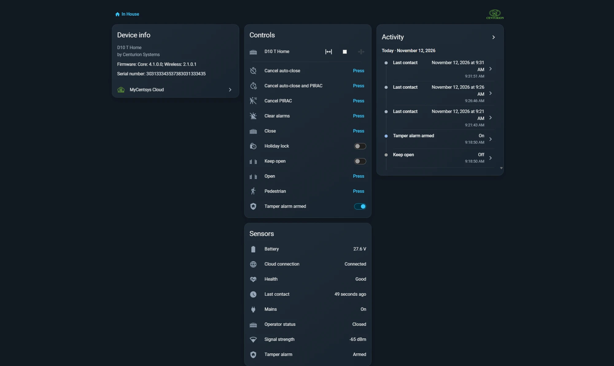
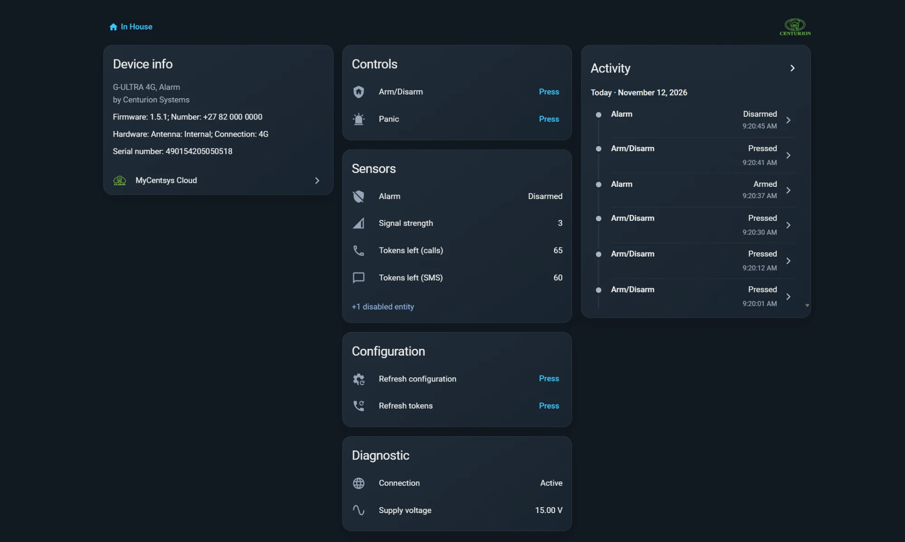

# MyCentsys Cloud for Home Assistant

The official **Centurion Systems** integration for Home Assistant. Control the gates and garage
doors you already use in the **MyCentsys Remote** app from Home Assistant: open, close and stop
with live position, the app's status tiles, and your G-ULTRA devices' outputs and inputs.

It runs **alongside** the app, not instead of it: the app keeps working and keeps receiving its
notifications while Home Assistant is connected.

A G-ULTRA device arrives as what it was set up to be. When its setup wizard has been run in the
**G-WEB ULTRA** app, Home Assistant shows it as that device: a gate, a garage door, an alarm or
an electric fence. When the wizard has not been run, it appears as a general input/output
device, with every output and input under the name your installer gave it.

---

## What you need

- A running setup of the **MyCentsys Remote** app. The mobile number you sign in with in Home
  Assistant must be the one registered in the app.
- At least one [supported device](#supported-devices) linked to that number in the app.
- **Home Assistant 2024.12** or newer. Version 2026.3 or newer also shows the integration's icon
  and logo.
- For the recommended installation: the **Marketplace** that is built into Home Assistant 2026.11
  and newer, or **[HACS](https://hacs.xyz/)** on older versions.

---

## Supported devices

| Device | Connection | What you get |
| --- | --- | --- |
| SMART+ operators (D3, D5, D5-Evo, D6, D10, D10 TURBO, D20, SDO5 SMART+, VANTAGE, ...) | Wi-Fi | Open, close and stop with live position, Pedestrian, Holiday Lock, Keep Open, battery, mains, health, tamper alarm |
| G-ULTRA and G-SPEAK ULTRA devices (2G, 3G, Penta, 4G, 4GS) | GSM | Open, close and stop for a gate or garage door, every output as a button or switch, every input as a status sensor, live position when a status input is wired, diagnostics |

For a SMART operator your number must be a **remote user** on the operator; for an ULTRA device it
must be an **access number** on the device.

Bluetooth-only operators (for example a D10 SMART without Wi-Fi) are not supported.

---

## Installation

### Marketplace or HACS (recommended)

The button opens this repository in the Marketplace on Home Assistant 2026.11 and newer, and in
HACS on older versions. To add it by hand instead:

**Home Assistant 2026.11 and newer (Marketplace)**

1. Go to **Settings -> Marketplace** and select **Add from link**.
2. Under **GitHub link**, enter `https://github.com/Centurion-Systems/MyCentsys-Cloud` and select
   **Add**.
3. Open MyCentsys Cloud, select **Install**, and confirm.

**Older versions (HACS)**

1. In HACS open **⋮ -> Custom repositories** and add
   `https://github.com/Centurion-Systems/MyCentsys-Cloud` with the type **Integration**.
2. **Download** MyCentsys Cloud and restart Home Assistant.

Home Assistant tells you when a new version is available. Once the integration is in the
catalog, you can simply search for **MyCentsys Cloud** instead.

### Manual

1. Download the latest [release](https://github.com/Centurion-Systems/MyCentsys-Cloud/releases).
2. Copy `custom_components/mycentsys_cloud` into your Home Assistant `config/custom_components/`
   folder.
3. Restart Home Assistant.

---

## Setup

1. Click the button above, or go to **Settings -> Devices & Services -> Add Integration ->
   MyCentsys Cloud**.
2. Choose your **country code** and enter your **mobile number** in digits.
3. Choose **WhatsApp** or **SMS** for the one-time PIN and enter it.
4. Choose your **devices**: all of them, SMART operators only, ULTRA devices only, or the ones you
   pick from a searchable list.

No YAML is needed. The devices and how often ULTRA devices are read can be changed later under
**Configure**: see [Configuration](docs/configuration.md).

<!-- Screenshot placeholder: the setup dialog (docs/images/setup.png) -->

---

## What you get

- **SMART operators**: a gate or garage door with open, close and stop and live position, the
  app's status row (operator status, battery, power supply, health, tamper alarm), and the
  operator's own controls such as Pedestrian, Holiday lock and Keep open.
- **G-ULTRA and G-SPEAK ULTRA devices**: a gate or garage door when one is wired, every output as a
  button or switch and every input as a status sensor under the names your installer gave them,
  an alarm panel when an alarm is wired, signal strength, and call and SMS tokens or the network
  balance, depending on the SIM.
- **Shared gates**: gates shared with your number, with their remaining uses and expiry.

The full list, and how ULTRA devices are recognised, is in [Entities](docs/entities.md).

---

## Troubleshooting

- **No PIN arrives**: check that the number is the one registered in the MyCentsys Remote app and
  that the country is right.
- **No gates listed**: open the app with the same number. If the gate is not there, its admin has
  to add your number.
- **An action is refused**: the message is the operator's own answer, for example busy or offline.

More answers, and how to turn on debug logging, are in [Troubleshooting](docs/troubleshooting.md).
Report problems and ideas on the [issue tracker](https://github.com/Centurion-Systems/MyCentsys-Cloud/issues).

---

## Contributing

Contributions are welcome. See [CONTRIBUTING.md](CONTRIBUTING.md) for setting up, running the tests
and opening a pull request. Release notes are in [CHANGELOG.md](CHANGELOG.md).

## Licence

The code and documentation are licensed under the MIT licence, copyright Centurion Systems (Pty)
Ltd. See [LICENSE](LICENSE).

The Centurion Systems name and logo and the MyCentsys Cloud icon (the images in the `brand`
folders) are Centurion Systems brand assets. They are not covered by the MIT licence and may only
be used to identify this integration.
